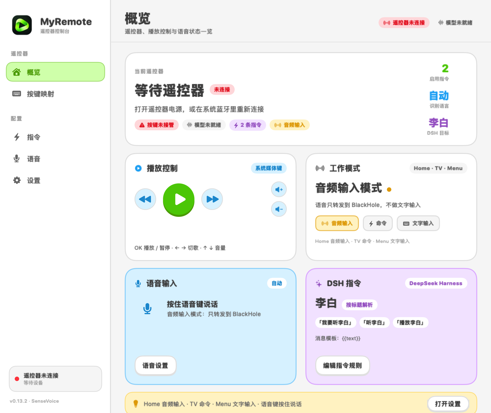
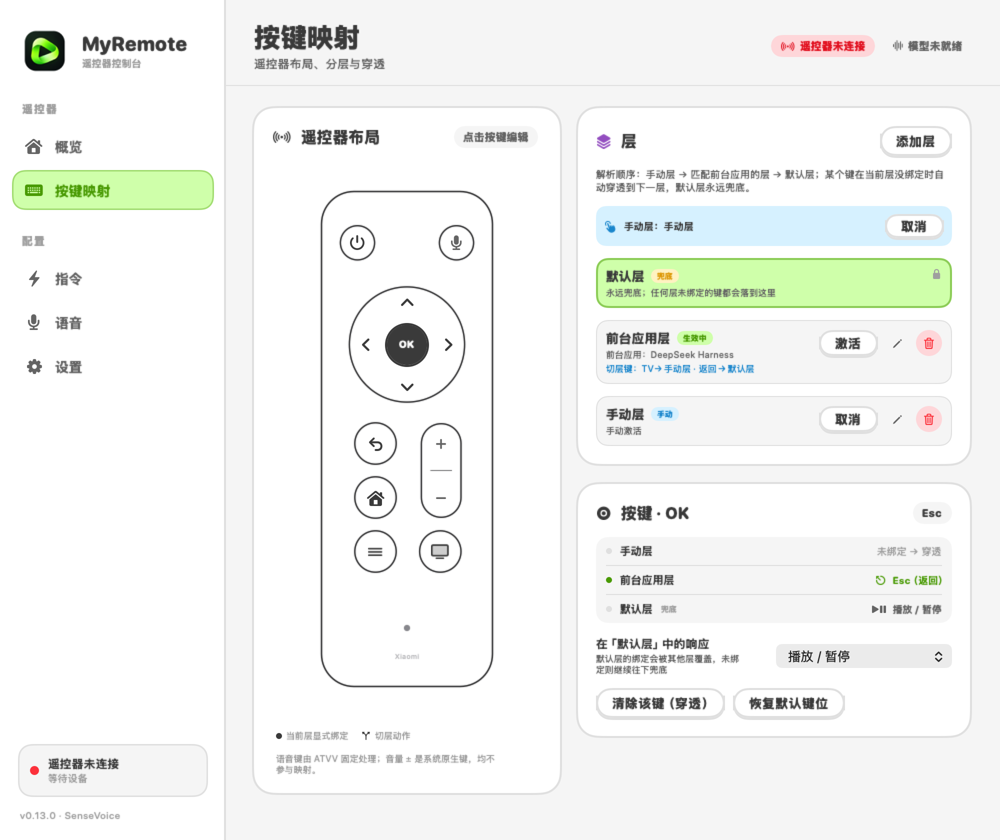

# MyRemote

把**小米蓝牙遥控器 2 Pro**变成 macOS 的媒体遥控器、离线语音输入设备和可编程按键面板。



`v0.13.0` · macOS 14+ · Apple Silicon · MIT

## 演示

https://github.com/user-attachments/assets/30bdf227-e75d-463a-8728-1120c050484d

完整演示（约 58 秒）：按 TV 进入命令模式，说「我要听明天」，由 DSH 接管并播放音乐。

## 功能

- **媒体遥控**：OK 播放/暂停，↑↓ 音量，←→ 上一首/下一首；通过系统媒体键控制任何「正在播放」的应用。
- **本地语音识别**：按住语音键说话，松手后用 [SenseVoice](https://github.com/QwenAudio/SenseVoice) 离线转文字，不经过云端。
- **三种模式**：
  - `Home` 音频输入模式：只把语音转发到 BlackHole，不做文字输入；
  - `TV` 命令模式：语音识别后匹配指令并自动执行；
  - `Menu` 文字输入模式：语音识别后粘贴到前台输入框。
- **语音共享**：配合 [BlackHole 2ch](https://existential.audio/blackhole/)，其他 App 可以把遥控器当麦克风。
- **联动 DeepSeek Harness**：命令模式识别出的文字可以直接投递到本机 DSH 会话，由 Agent 控制电脑，例如播放音乐、打开应用。
- **按键映射**：可视化遥控器布局，支持默认层 / 应用层 / 手动层、穿透兜底；动作可映射到媒体/系统键、模式切换、打开应用/网页、运行 Shell、发送到 DSH、任意键盘 keycode（如回车）。
- **Web 遥控器**：Mac 内置局域网 HTTPS 页面，手机扫码即可按键遥控，并把手机麦克风通过 WebSocket PCM 送进同一套 ASR / BlackHole 链路。
- **权限向导**：拖拽 App 图标到系统设置完成辅助功能 / 输入监控授权。
- **菜单栏常驻**：状态、电量、模式切换、模型/声卡状态和常用操作。

## 安装

**要求**：macOS 14 或更高，Apple Silicon，安装 Xcode Command Line Tools。

```bash
git clone <repo>
cd MyRemote
./scripts/package.sh
open dist/MyRemote.app
```

也可以直接解压 `dist/MyRemote-0.13.0.zip` 后拖进「应用程序」。

首次启动：

1. 按提示完成**辅助功能**、**输入监控**、**蓝牙**授权（权限向导会打开系统设置并浮出拖拽引导）。
2. 打开遥控器电源，在系统蓝牙里连接 **Xiaomi Bluetooth Remote 2 Pro**。
3. 首次使用语音会自动下载约 239MB 的 SenseVoice 模型（也可在「语音」页手动下载）。
4. 如需语音共享，安装 [BlackHole 2ch](https://existential.audio/blackhole/)，然后在「语音 → 语音共享」中开启。

> 旧版 MiRemote 与本应用不能同时运行。

## Web 遥控器（可选）

设置窗口 →「Web 遥控器」打开开关，Mac 会在局域网启动 HTTPS 服务，手机扫码打开一个模拟遥控器页面。按键会复用当前按键映射，手机麦克风支持两种用法：

- **音频输入模式**：手机按住说话，PCM 直接转发到 BlackHole，会议/录音软件选 `BlackHole 2ch` 即可把手机当无线麦克风；
- **命令 / 文字输入模式**：手机 PCM 进入 SenseVoice，命令模式匹配指令，文字输入模式粘贴到 Mac 前台输入框。

首次使用：

1. 手机与 Mac 连接同一个 Wi-Fi（访达 → 网络里的 Mac 也可以）。
2. 在设置页点「打开 CA 文件夹」，把 `ca.crt` 通过 AirDrop 发到手机。
3. iPhone：设置 → 已下载描述文件 → 安装；再进入 通用 → 关于本机 → 证书信任设置，对 **MyRemote Local CA** 开启完全信任。
4. 用手机相机扫描设置页二维码，Safari 打开；允许麦克风。
5. macOS 如果弹出防火墙或「本地网络」权限询问，允许 MyRemote 接受局域网连接。

注意：页面必须通过 HTTPS 打开，浏览器才会授予麦克风权限；Mac 的局域网 IP 变化后会重新签发服务器证书（CA 不变），手机不需要重新安装 CA。Web 端能触发当前按键映射（包括 Shell / DSH），请只在可信局域网开启，不用的时候关掉开关。

## 发布

推送 `v*` tag 会自动在 GitHub Actions 的 Apple Silicon runner 上构建、自检并创建 Release：

```bash
git tag v0.13.0
git push origin v0.13.0
```

也可以在仓库的 **Actions → Release → Run workflow** 手动触发（填版本号）；勾选 `create_release` 时会用 `v<版本>` 作为 tag 创建 Release，不勾选则只上传构建 artifact。产物包含 `MyRemote-<版本>.zip` 和 SHA-256 校验文件。

默认产物是 ad-hoc 签名；要发布给其他用户，需配置 Developer ID 签名和公证。

## 使用

**默认键位**

| 键 | 动作 |
|---|---|
| OK | 播放 / 暂停 |
| ↑ / ↓ | 音量 + / - |
| ← / → | 上一首 / 下一首 |
| 返回 | Esc |
| Home | 音频输入模式（语音转发） |
| TV | 命令模式 |
| Menu | 文字输入模式 |
| 电源 | 显示器睡眠 |
| 语音 | 按住说话；按当前模式转发 / 识别为指令 / 识别为文字 |

**语音共享**：音频输入模式下，在微信 / 会议 / 录音软件中把麦克风选为 `BlackHole 2ch`。命令和文字输入模式不会转发音频。

**按键映射**：设置窗口 →「遥控器 → 按键映射」，点遥控器上的按键，为当前层选择动作。默认层永远兜底；可添加按前台应用自动激活的层，或用手动层 / 切层键临时覆盖。

**实时预览**：命令模式和文字输入模式下，按住语音键时约每 0.9 秒会对已录到的音频重新识别一次，「聆听中…」后面的文字会持续更新；松手后再用完整音频做最终识别。音频输入模式不做识别。

**快捷键**：`⌘W` 关闭窗口，`⌘Q` 退出，`⌘,` 打开设置，`⌘M` 最小化；输入框支持 `⌘A / ⌘C / ⌘V / ⌘X / ⌘Z`。

**命令示例**：按 TV 进入命令模式，说「打开大肥鱼」即可启动或切换到 DeepSeek Harness。

### 配合 DeepSeek Harness 控制电脑

MyRemote 负责「听」和「按键」，具体操作可以交给本机正在运行的 DeepSeek Harness：

1. 确保 DSH 已启动，并有一个目标会话（例如 `MyRemote` 工作区里的「李白」）。
2. 打开「指令」页，新建一条规则：
   - 触发短语：`播放音乐`、`我要听李白`；
   - 动作：**发送到 DSH 会话** → 选择目标会话。
3. 按 TV 进入命令模式，说「播放音乐」。
4. MyRemote 把识别文本通过本机接口投递到该会话，由会话里的 Agent 打开音乐 App、搜索并播放。

也可以把某个按键的映射动作设为「发送到 DSH」，实现一键触发。投递只走本机 `127.0.0.1`，不经过云端；具体能执行哪些操作取决于 DSH 会话的配置。



## 注意事项

- 仅支持小米蓝牙遥控器 2 Pro（VID `0x2717` / PID `0x32B8`）。
- 语音键和音量 ± 不参与按键映射：前者由 ATVV 协议固定处理，后者是系统原生音量键。
- 语音识别和按键接管全部在本机完成，不上传音频或识别文本。

## 致谢

- [MiRemote](https://github.com/godarrenw/mi_remote_control)：ATVV 语音链路、ADPCM 解码与 HID 按键接管（MIT）。
- [BlackHole](https://existential.audio/blackhole/)：虚拟声卡，用于把遥控器语音共享给其他应用。
- [SenseVoice](https://github.com/QwenAudio/SenseVoice)：本地多语种语音识别模型。
- [DeepSeek Harness](https://github.com/deepseek-ai/deepseek-harness)：可选的指令执行与会话集成。

## License

MIT
